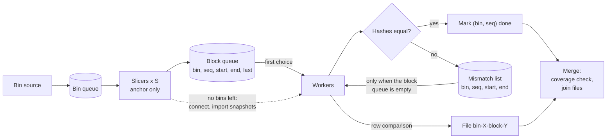

# Parallel block matching of a table across instances

This document describes a method to compare one table on several PostgreSQL
instances in parallel. The method cuts the key space of the table into blocks,
hashes every block on every instance and compares the hashes. Only blocks with
different hashes need a closer look.

The method does not depend on a specific tool. It only needs a primary key (or
another unique, not null key with a B-tree index) and normal SQL access to
every instance.

## 1. Goals

- Use the parallelism that the instances allow, and no more.
- Even out the skew of work: blocks of different cost and bins of different
  size.
- Touch every row of the compared state exactly once, and be able to check it.
- Keep client memory small and known before the start.
- Never compare key values on the client.

## 2. Assumptions

1. **N connections per instance.** N is computed once, before the start, and
   is the same on every instance. In practice N is the minimum over the
   instances.
   - N = 1: one process cuts and hashes in turn.
   - N = 0 on any instance: the run does not start.
2. **One snapshot per instance.** On every instance one connection exports a
   snapshot, and every other connection of that instance imports it. All work
   on an instance happens in this one snapshot.
3. **The key is an opaque value.** The client stores key values and sends them
   back to the server as query parameters. It never orders them with `<` or
   `>`. Equality, where needed, is a byte comparison of the same value.
4. **Bins come from any source.** A bin source splits the key space into
   K >= 1 ranges. It can use the column histogram, a sample, a ready map of
   ranges, or give one bin for the whole key space. The method does not depend
   on the source. Bins may be uneven; this costs some time but never changes
   the result.

## 3. Terms

| Term | Meaning |
|---|---|
| Instance | One PostgreSQL server that holds a copy of the table. |
| Anchor | The instance where blocks are cut. |
| Bin | A range of the key space `[Lo, Hi)`, a unit of work for one slicer. The first bin has no lower bound, the last bin has no upper bound. |
| Block | A range of keys `[start, end)` inside a bin, at most `block_size` rows on the anchor. The unit that every instance hashes. |
| Slicer | A process that walks one bin on the anchor and cuts it into blocks. |
| Worker | A process that takes a block, hashes it on every instance and compares the hashes. |
| Merger | The final step: checks coverage and joins the mismatch files. |
| Exporter | On each instance, the connection that exports the snapshot. It is one of the workers. |

## 4. Architecture



There are three queues:

- the **bin queue** holds bins that are not cut yet;
- the **block queue** holds blocks that are cut but not yet hashed. All
  slicers write to it, and all workers read from it;
- the **mismatch list** holds blocks whose hashes differ and whose rows are
  not compared yet.

A worker does not care which slicer cut a block. This is why the skew evens
out by itself: a worker that finishes early takes the next block.

Work has two kinds with different cost. Hashing is cheap and uniform. Row
comparison is expensive and happens only for mismatched blocks. A worker
always prefers hashing and takes a row comparison only when it finds no block
to hash. This is a soft barrier: there is no point where all workers wait for
each other, but hashing goes first.

## 5. Algorithm

### 5.1 Start

1. Compute N. Stop if N = 0 on any instance.
2. On every instance open the first connection, start a `REPEATABLE READ`
   read-only transaction and call `pg_export_snapshot()`. This connection is
   the exporter and later works as a normal worker.
3. Open the other connections. Each starts a `REPEATABLE READ` read-only
   transaction and runs `SET TRANSACTION SNAPSHOT '<id>'` before any query.
4. Ask the bin source for K bins and put them into the bin queue. Bins are
   numbered 0 .. K-1 in key order.
5. Start S = min(K, N / 4) slicers on the anchor (at least 1) and N - S
   workers. The ratio 1/4 is a rule of thumb: cutting reads only keys and is
   much cheaper than hashing a block on every instance.

### 5.2 Slicer

A slicer takes a bin from the bin queue and walks it in key order by the
index:

1. It finds the first key of the bin.
2. It asks the server for the key that is `block_size` rows further in index
   order. The server does the ordering; the client only receives the key.
   One query can return several block starts at once.
3. Each found key closes the current block and opens the next one. The block
   goes to the block queue with its name `(bin, seq)`, its bounds and a
   `last` flag. `seq` starts at 0 in every bin.
4. The last block of a bin ends at the bin's upper bound and has `last` set.

Because each block starts where the previous one ends, the blocks of a bin
cover the bin with no gaps and no overlaps: `[Lo, b1), [b1, b2) ... [bn, Hi)`.

When the bin queue is empty, the slicer **switches** to the worker role. It
opens connections to the other instances and imports their snapshots. If this
works, it becomes a worker. If it cannot get the connections, it stops.

### 5.3 Worker

A worker repeats:

1. If the block queue has a block, take it and **hash** it:
   - send the hash query for the block to every instance at the same time.
     The query returns the hash of the rows in `[start, end)` and their count;
   - all hashes equal: mark `(bin, seq)` as done;
   - not equal: put `(bin, seq, start, end)` into the mismatch list and mark
     `(bin, seq)` as hashed.
2. Else, if the mismatch list has an entry, take it and **compare rows**:
   - read the rows of `[start, end)` from every instance, in the same
     snapshot;
   - match rows by key equality only (a byte comparison of the key value), no
     ordering on the client;
   - write a file named `bin-X-block-Y` with the result and mark `(bin, seq)`
     as done.
3. Else wait: a slicer may still produce blocks, or another worker may still
   add a mismatch.

Hashing and row comparison see the same snapshot, so a block that waits in the
mismatch list is compared in the same state of the data as it was hashed. The
delay costs nothing in consistency.

Files are written only for mismatched blocks. The format of the report is out
of scope here.

One more effect of the soft barrier: when one slicer cannot feed all workers
(for example with one bin), the workers that find no block to hash compare
rows instead of waiting.

### 5.4 End

The run ends when the bin queue, the block queue and the mismatch list are
empty and every worker is idle. The merger then:

1. Checks coverage (section 7).
2. Reads the files in `(bin, seq)` order and joins them into one report. Each
   file is deleted as soon as it is read.

## 6. Block identity and order

A block is identified by `(bin, seq)`. This name gives the full key order of
the blocks without any key comparison on the client:

- bins are numbered in key order when they are created;
- `seq` grows in key order inside a bin.

The first block of the table is `(0, 0)` with an open lower bound. The last
block is the block with `last` set in bin K-1, with an open upper bound. Open
bounds matter: other instances may hold rows below the smallest or above the
largest key of the anchor.

A global block number is not needed during the run. If a report needs one, the
merger can give it, because it reads the blocks in order.

## 7. Coverage

**Guarantee.** Bins cover the whole key space. Blocks cover each bin with no
gaps and no overlaps. All blocks of one instance are hashed in the one snapshot
of that instance. So every row of that snapshot belongs to exactly one block.

**Check.** For every bin, the marks (hashed or done) must hold `seq = 0 .. k`
with no gaps,
and block `k` must have `last` set. This check is cheap and needs no access to
the instances.

**Optional check.** The hash query also returns the row count. The sum of the
counts of all blocks of an instance must equal the number of rows in its
snapshot. Counting the rows costs one more pass over the table in the same
snapshot, so this check is optional.

Snapshots of different instances are not consistent with each other. On a
table that changes during the run, a mismatch can show a real difference or a
change that one instance had and the other did not have yet.

## 8. Connections

| Instance | At the start | After the slicers switch |
|---|---|---|
| Anchor | S slicers + (N - S) workers | N workers |
| Any other | N - S workers | N workers |

Each worker holds one connection on every instance. While slicers cut, S
connections on every non-anchor instance are not opened yet; they are taken
only when a slicer switches.

The slicers add work to the anchor. It is better to choose as the anchor an
instance where this extra load hurts least.

## 9. Memory

The client keeps:

- the bin queue: K records;
- the block queue: two keys per block;
- the mismatch list: two keys per mismatched block;
- the blocks in work: at most N records;
- the marks: one small record per block.

The block queue and the mismatch list are the largest parts. Together they
never hold more blocks than the table has, so their size is known before the
start:

```
memory ≈ (rows / block_size) × 2 × key_width
```

`key_width` comes from the average width of the key columns in the statistics.
Example: 3.8 billion rows, blocks of 10 000 rows, a 100-byte key give about
76 MB, plus the client's own overhead for stored values.

The block queue does not need a bound. A slicer that waits for free space in
the queue starts to work as a worker later. A bound is useful only when the
estimate above is too large (a wide key and small blocks).

## 10. Errors

There are two classes of errors.

**Block error.** One query fails: a cancel, a timeout, a short network fault.
The snapshot is not lost. The worker starts a new `REPEATABLE READ`
transaction, imports the same snapshot again with `SET TRANSACTION SNAPSHOT`
and repeats the block. The number of attempts is limited. The method does not
use savepoints, so the normal path pays nothing for this.

**Snapshot or instance error.** The exporter or a whole instance is lost. The
snapshot cannot be imported again. The run stops and later starts from zero.

There is no resume. A result built from several snapshots cannot be read on a
table that changes, and a run of a table of hundreds of gigabytes takes
minutes, so a restart is cheap.

To keep the exporter alive:

- the exporter is a worker, so its session is always busy;
- its session sets `idle_in_transaction_session_timeout = 0`;
- before the start, check settings that can end a long snapshot: recovery
  conflicts on a standby, and `old_snapshot_threshold` on versions that have
  it.

## 11. Known costs

1. **Vacuum horizon.** Every instance holds one snapshot for the whole run.
   Vacuum cannot remove rows that this snapshot can still see. On a standby a
   long snapshot conflicts with recovery or, with `hot_standby_feedback`,
   delays vacuum on the primary.
2. **A block waits for its slowest instance.** A worker holds the block until
   every instance returns its hash. Let `c(i, b)` be the cost of block `b` on
   instance `i` and `W` the number of workers. The run time is close to
   `Σ_b max_i c(i, b) / W`. No method can be faster than
   `max_i Σ_b c(i, b) / W`, because every instance must do all its work. The
   difference is the cost of the per-block wait.
   - If one instance is slower on every block, the two values are equal and
     nothing is lost.
   - If the slow instance changes from block to block (cache state, bloat,
     more rows in some key ranges), the run can take up to M times longer
     for M instances (two times for two) in the worst case. For similar
     replicas the loss is small.
3. **One bin means one slicer.** With K = 1 a single slicer must feed N - 1
   workers. At large N it can limit the speed.
4. **Many files.** One file per mismatched block. If one instance is empty,
   every block mismatches.

## 12. Open questions

1. **A window between instances.** Hash queries of different instances could
   run on their own, with each instance allowed to run at most k·N blocks
   ahead of the oldest block that is not matched yet. k = 1 is the method
   above; no limit gives full decoupling, which needs to keep every hash until
   the end. Memory stays at O(k·N) records. Before building it, log the hash
   time of every block on every instance and compute both sums from section
   11.2 to see the real gain.
2. **Speed of one slicer.** Measure how many workers one slicer can feed, on a
   table with more than 100 million rows.
3. **Mismatch report.** Define what a worker writes into a block file.
4. **Joining neighbours in the mismatch list.** `(X, s)` and `(X, s+1)`, or
   the last block of bin X and `(X+1, 0)`, are neighbours by name, with no key
   comparison. A worker could compare rows of a run of neighbours as one range.
   With the soft barrier, only neighbours already in the list can be joined.
5. **Long blocks.** A block that is much more expensive on one instance than
   on the others could be cancelled and cut into smaller blocks on that
   instance, in the same snapshot.
6. **Other tools.** The slicer does not depend on what consumes its blocks.
   It can feed any tool that compares key ranges block by block.
